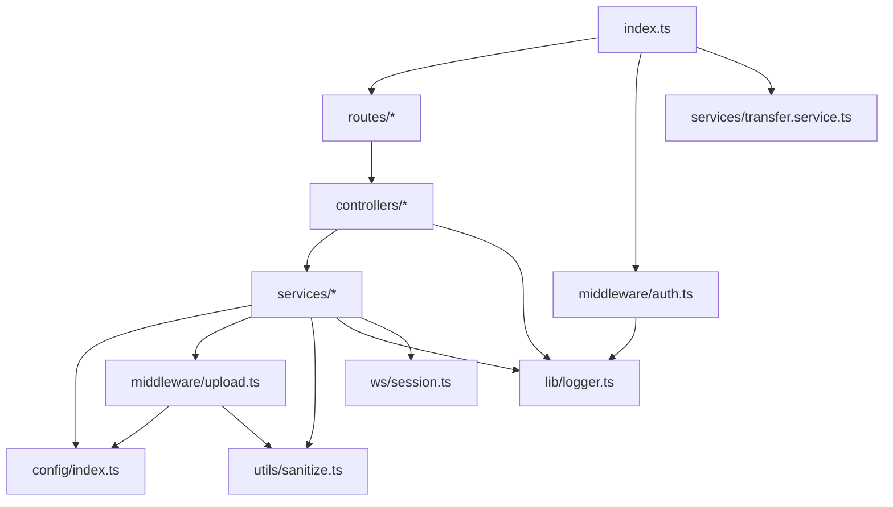
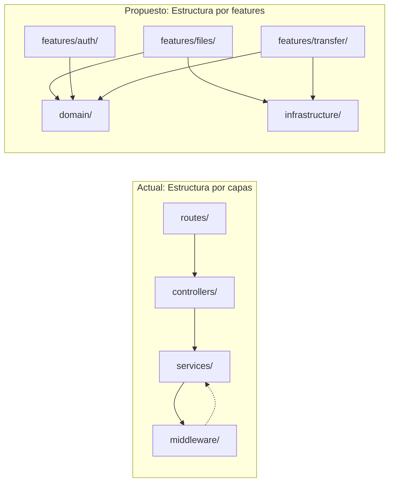

# Revisión de Arquitectura — Backend SrvFiles

> **Fecha:** 28 de marzo de 2026  
> **Alcance:** `backend/src/` — 20 archivos TypeScript, ~1.200 LOC  
> **Stack:** Express 4 · TypeScript · WebSocket (ws) · Winston · Multer

---

## 1. Estructura actual

```
backend/src/
├── index.ts                  ← Entry point (Express app + HTTP + WS server)
├── config/
│   └── index.ts              ← Variables de entorno + getLanIp()
├── controllers/
│   ├── config.controller.ts
│   ├── discovery.controller.ts
│   ├── files.controller.ts
│   └── health.controller.ts
├── routes/
│   ├── auth.route.ts         ← ⚠ Contiene lógica de controller inline
│   ├── config.route.ts
│   ├── discovery.route.ts
│   ├── files.route.ts
│   └── health.route.ts
├── services/
│   ├── discovery.service.ts
│   ├── files.service.ts
│   └── transfer.service.ts   ← ⚠ Monolítico: 310 líneas, múltiples responsabilidades
├── middleware/
│   ├── auth.ts               ← ⚠ Mezcla estado (PIN/sesiones/rate-limit) + middleware Express
│   └── upload.ts
├── lib/
│   └── logger.ts
├── types/
│   └── index.ts              ← DTOs compartidos (FileInfo, AppConfig, etc.)
├── utils/
│   └── sanitize.ts
└── ws/
    └── session.ts            ← ECDH + AES-256-GCM por conexión WS
```

### Diagrama de dependencias



---

## 2. Lo que está bien ✅

| Aspecto | Detalle |
|---|---|
| **Separación de capas** | Rutas → Controllers → Services claramente definidos |
| **Responsabilidad única (parcial)** | `files.controller.ts` solo maneja HTTP; delega a `files.service.ts` |
| **Documentación** | JSDoc completo en casi todas las funciones públicas |
| **Seguridad** | PIN + sesión con SHA-256, rate limiting, sanitización de filenames, ECDH key exchange en WS |
| **Logging** | Winston con formato personalizado, logs a archivo y consola |
| **Tipado estricto** | Interfaces bien definidas en `types/index.ts` |
| **Testing** | Tests existentes para auth y rutas con Vitest + Supertest |

---

## 3. Problemas detectados 🔍

### 3.1 — `auth.route.ts` mezcla ruta y lógica de controller

El handler POST `/api/auth` vive directamente en el archivo de ruta en lugar de en un `auth.controller.ts`. Rompe el patrón consistente del resto del proyecto.

```typescript
// auth.route.ts (actual) — lógica inline ❌
router.post('/', (req: Request, res: Response) => {
  // … validación PIN, rate limit, sesión — todo inline
});
```

### 3.2 — `middleware/auth.ts` tiene múltiples responsabilidades

Este archivo concentra cuatro dominios distintos:

1. **Gestión de PIN** — `generatePin()`, `validatePin()`, `getPin()`
2. **Gestión de sesiones** — `createSession()`, `validateToken()`
3. **Rate limiting** — `checkRateLimit()`, `recordFailedAttempt()`
4. **Middleware Express** — `requireAuth()`

Son responsabilidades independientes que deberían vivir en módulos separados.

### 3.3 — `transfer.service.ts` es un monolito de 310 líneas

Este archivo maneja:
- Gestión de clientes conectados (Map de state)
- Protocolo de transferencia P2P (request/accept/reject/cancel/complete)
- Relay de chunks binarios cifrados
- Autenticación WS
- Key exchange
- Broadcast de eventos
- Cifrado/descifrado de mensajes

Todo en un solo `ws.on('message')` callback con un `switch` de 7 casos. Es el archivo con mayor riesgo de crecimiento descontrolado.

### 3.4 — Estado global mutable sin abstracción

```typescript
// En transfer.service.ts
const clients = new Map<string, ConnectedClient>();
const transfers = new Map<string, TransferSession>();

// En middleware/auth.ts
let pinHash: string | null = null;
let pinPlain: string | null = null;
const sessions = new Map<string, true>();
const rateLimitMap = new Map<string, { count: number; blockedUntil: number }>();
```

Estos estados viven como **variables de módulo**. Funciona por ahora, pero dificulta testing (no se pueden inyectar/resetear) y no escala a múltiples instancias.

### 3.5 — No existe una capa de errores

Los controllers manejan errores con `try/catch` genéricos:

```typescript
} catch (err) {
  log.error('files.controller.ts', 'Error al subir archivos', { error: String(err) });
  res.status(500).json({ error: 'Failed to upload files' });
}
```

No hay errores de dominio tipados (e.g. `FileNotFoundError`, `InvalidFilenameError`) que permitan mapear automáticamente a códigos HTTP.

### 3.6 — `config/index.ts` mezcla constantes y lógica de red

`getLanIp()` es una función de infraestructura de red que vive en la configuración. No debería estar ahí.

### 3.7 — Dependencias cruzadas entre capas

- `files.service.ts` importa `UPLOADS_DIR` desde `middleware/upload.ts` → un servicio depende de un middleware.
- `transfer.service.ts` importa `validateToken` desde `middleware/auth.ts` → un servicio depende directamente de un middleware.
- `index.ts` importa funciones directamente desde `middleware/auth.ts` en lugar de usar inyección.

### 3.8 — Tipos inline en `transfer.service.ts`

Las interfaces `ConnectedClient` y `TransferSession` están definidas dentro del service en vez de en `types/`. Además, `DiscoveredServer` está definida en `discovery.service.ts` en lugar de en el módulo de tipos.

---

## 4. Propuesta de mejora

### 4.1 — Reestructurar por dominio (Feature-based)

> No se propone una arquitectura hexagonal completa porque el proyecto es relativamente pequeño (~1.200 LOC). Sin embargo, se pueden tomar **principios de Clean Architecture / Ports & Adapters** sin sobreingeniería.

```
backend/src/
├── index.ts                         ← Solo bootstrap: crea app, arranca server
├── app.ts                           ← [NUEVO] Crea y configura Express app
│
├── config/
│   └── index.ts                     ← Solo constantes de env (sin getLanIp)
│
├── domain/                          ← [NUEVO] Capa de dominio pura
│   ├── errors.ts                    ← AppError, FileNotFoundError, etc.
│   └── types.ts                     ← Interfaces de negocio (FileInfo, etc.)
│
├── features/                        ← [NUEVO] Agrupado por feature/dominio
│   ├── files/
│   │   ├── files.route.ts
│   │   ├── files.controller.ts
│   │   └── files.service.ts
│   ├── auth/
│   │   ├── auth.route.ts
│   │   ├── auth.controller.ts       ← [NUEVO] Extraer lógica de auth.route.ts
│   │   ├── auth.service.ts          ← [NUEVO] PIN + sesiones
│   │   ├── auth.middleware.ts        ← Solo middleware requireAuth
│   │   └── rate-limiter.ts          ← [NUEVO] Rate limiting aislado
│   ├── transfer/
│   │   ├── transfer.handler.ts      ← Manejo de conexión WS
│   │   ├── transfer.service.ts      ← Lógica de negocio de transferencias
│   │   ├── client-registry.ts       ← [NUEVO] Gestión del Map de clientes
│   │   └── session.ts               ← Cifrado ECDH (actual ws/session.ts)
│   ├── discovery/
│   │   ├── discovery.route.ts
│   │   ├── discovery.controller.ts
│   │   └── discovery.service.ts
│   ├── config/
│   │   ├── config.route.ts
│   │   └── config.controller.ts
│   └── health/
│       ├── health.route.ts
│       └── health.controller.ts
│
├── infrastructure/                  ← [NUEVO] Adaptadores de infra
│   ├── logger.ts
│   ├── network.ts                   ← getLanIp(), getSubnetIPs()
│   └── storage.ts                   ← [NUEVO] Upload config + UPLOADS_DIR
│
└── shared/                          ← [NUEVO] Utilidades transversales
    ├── middleware/
    │   └── error-handler.ts         ← [NUEVO] Middleware global de errores
    └── utils/
        └── sanitize.ts
```

### 4.2 — Implementar errores de dominio

```typescript
// domain/errors.ts
export class AppError extends Error {
  constructor(
    public readonly message: string,
    public readonly statusCode: number = 500,
    public readonly code: string = 'INTERNAL_ERROR',
  ) {
    super(message);
  }
}

export class FileNotFoundError extends AppError {
  constructor(filename: string) {
    super(`File "${filename}" not found`, 404, 'FILE_NOT_FOUND');
  }
}

export class InvalidFilenameError extends AppError {
  constructor(filename: string) {
    super(`Invalid filename: "${filename}"`, 400, 'INVALID_FILENAME');
  }
}
```

Con un **error handler global** que mapea automáticamente:

```typescript
// shared/middleware/error-handler.ts
export function errorHandler(err: Error, _req: Request, res: Response, _next: NextFunction) {
  if (err instanceof AppError) {
    res.status(err.statusCode).json({ error: err.message, code: err.code });
    return;
  }
  log.error('error-handler', 'Unhandled error', { error: String(err) });
  res.status(500).json({ error: 'Internal server error' });
}
```

Esto elimina los `try/catch` repetitivos de cada controller.

### 4.3 — Separar `app.ts` de `index.ts`

```typescript
// app.ts — Crea y retorna la aplicación Express configurada
export function createApp(): express.Express { ... }

// index.ts — Solo bootstrap
const app = createApp();
const server = http.createServer(app);
server.listen(PORT, HOST, ...);
```

**Beneficio:** Permite testear la app sin arrancar el server HTTP.

### 4.4 — Descomponer `transfer.service.ts`

| Módulo nuevo | Responsabilidad |
|---|---|
| `client-registry.ts` | `Map<string, ConnectedClient>`, métodos `add/remove/get/broadcast` |
| `transfer.service.ts` | Lógica de negocio: request, accept, reject, cancel, complete |
| `transfer.handler.ts` | `handleConnection()`: parsea mensajes y los despacha |

### 4.5 — Inyección de dependencias (ligera)

No es necesario un contenedor DI completo. Basta con pasar dependencias como parámetros de factory:

```typescript
// Antes (acoplamiento directo):
import { UPLOADS_DIR } from '../middleware/upload';

// Después (inyección por constructor/factory):
export function createFilesService(uploadsDir: string) {
  return {
    listFiles(): FileInfo[] { /* usa uploadsDir */ },
    // ...
  };
}
```

Esto desacopla el servicio de la capa HTTP y facilita los tests unitarios.

### 4.6 — Consolidar tipos

Mover **todas** las interfaces a `domain/types.ts`:
- `FileInfo`, `UploadedFileInfo`, `DiskStats`, `AppConfig` (actualmente en `types/index.ts`)
- `ConnectedClient`, `TransferSession` (actualmente inline en `transfer.service.ts`)
- `DiscoveredServer` (actualmente en `discovery.service.ts`)

---

## 5. Tabla resumen: Patrones aplicables

| Patrón | Aplicabilidad | Prioridad |
|---|---|---|
| **Feature-based structure** | Agrupar por dominio en vez de por capa técnica | 🟢 Alta |
| **Error handling centralizado** | Eliminar try/catch repetitivo | 🟢 Alta |
| **Separar app.ts / index.ts** | Testabilidad | 🟢 Alta |
| **Descomponer transfer.service** | SRP, mantenibilidad | 🟡 Media |
| **Extraer auth.controller.ts** | Consistencia | 🟡 Media |
| **Inyección de dependencias (ligera)** | Testabilidad, desacoplamiento | 🟡 Media |
| **Repository Pattern** | Abstraer acceso a filesystem (uploads) | 🟡 Media |
| **Hexagonal / Ports & Adapters** | Completa, solo si el proyecto crece significativamente | 🔴 Baja |

> [!IMPORTANT]
> **Recomendación pragmática:** No todo necesita implementarse de golpe. Las mejoras de **prioridad alta** (feature-based structure, error handling, app.ts) se pueden hacer incrementalmente sin romper funcionalidad existente. La arquitectura hexagonal completa sería sobreingeniería para un proyecto de ~1.200 LOC, pero adoptar sus principios selectivamente (separar dominio de infraestructura) ya aporta valor.

---

## 6. ¿Hace falta Arquitectura Hexagonal completa?

**Para este proyecto, no.** La arquitectura hexagonal brilla en aplicaciones con:
- Múltiples fuentes de datos (BD, APIs externas, colas)
- Lógica de negocio compleja con reglas cambiantes
- Necesidad de swappear adaptadores (ej: cambiar de PostgreSQL a MongoDB)

SrvFiles es un servidor de archivos con lógica directa. Los principios útiles que sí se pueden tomar:

1. **Separar dominio de infraestructura** → `domain/` con tipos y errores puros
2. **Invertir dependencias** → Services no importan de middleware; reciben dependencias
3. **Ports** → Interfaces para storage y network que se pueden mockear en tests

Pero no necesita ports formales, adaptadores explícitos, ni use cases como clases. El patrón feature-based con servicios funcionales es suficiente.

---

## 7. Comparación visual: Antes vs. Después



---

*Documento generado como referencia para futuras refactorizaciones del backend de SrvFiles.*
