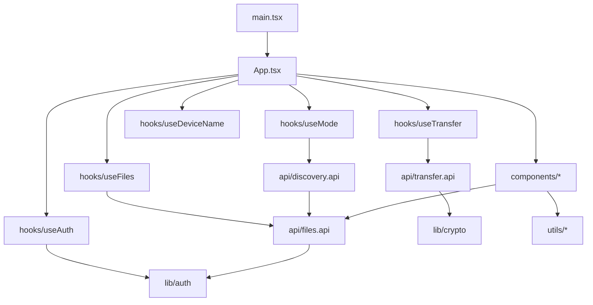
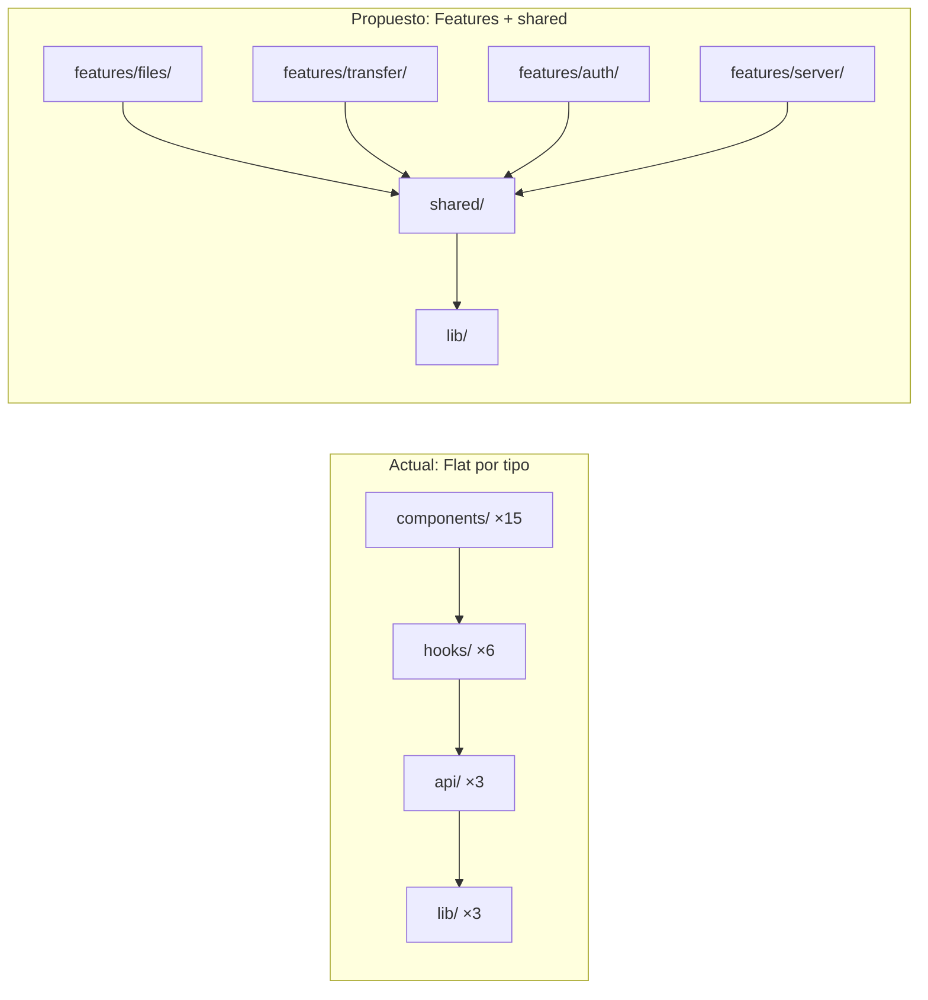

# Revisión de Arquitectura — Frontend SrvFiles

> **Fecha:** 28 de marzo de 2026  
> **Alcance:** `frontend/src/` — 38 archivos TypeScript/TSX, ~4.500 LOC + 2.000 LOC CSS  
> **Stack:** React 19 · Vite 6 · TypeScript · Axios · WebSocket · Tauri API · Sonner · react-dropzone · qrcode.react

---

## 1. Estructura actual

```
frontend/src/
├── main.tsx                         ← Entry point
├── App.tsx                          ← ⚠ God component (347 líneas, 3 componentes inline)
├── index.css                        ← ⚠ Monolito CSS (2.004 líneas)
│
├── api/                             ← Capa de comunicación con el backend
│   ├── files.api.ts                 ← Factory pattern con Axios + interceptors
│   ├── transfer.api.ts              ← Clase TransferConnection (WS + cifrado)
│   └── discovery.api.ts             ← Scan de red
│
├── hooks/                           ← Custom hooks de lógica de negocio
│   ├── useAuth.ts                   ← Autenticación PIN + auto-auth local
│   ├── useFiles.ts                  ← CRUD archivos + polling
│   ├── useTransfer.ts               ← ⚠ 298 líneas, protocolo P2P completo
│   ├── useMode.ts                   ← Detección de contexto (Tauri/browser/LAN)
│   ├── useDeviceName.ts             ← Nombre de dispositivo persistido
│   └── useDownloadDir.ts            ← Guardado de archivos (Tauri + browser fallback)
│
├── components/                      ← Componentes de UI
│   ├── DropZone.tsx                 ← Upload drag & drop (215 líneas)
│   ├── FileList.tsx                 ← Lista/grilla de archivos con búsqueda
│   ├── FileItem.tsx                 ← Item individual (list + grid)
│   ├── OnlineClients.tsx            ← Dispositivos conectados
│   ├── ServerSwitcherModal.tsx      ← ⚠ 336 líneas, modal complejo con auth inline
│   ├── PreviewModal.tsx             ← Vista previa de archivos
│   ├── IncomingTransferModal.tsx    ← Notificación de transferencia
│   ├── PinDialog.tsx                ← Diálogo de PIN
│   ├── ConfirmModal.tsx             ← Modal de confirmación
│   ├── NameModal.tsx                ← Renombrar dispositivo
│   ├── QRFooter.tsx                 ← QR con URL LAN
│   ├── DiskStats.tsx                ← Indicador de disco
│   └── preview/                     ← Sub-componentes de preview
│       ├── ImagePreview.tsx
│       ├── VideoPreview.tsx
│       ├── AudioPreview.tsx
│       ├── PdfPreview.tsx
│       ├── TextPreview.tsx
│       └── UnknownPreview.tsx
│
├── lib/                             ← Módulos de infraestructura
│   ├── auth.ts                      ← Token (sessionStorage) + authenticate()
│   ├── crypto.ts                    ← ECDH + AES-256-GCM (WebCrypto)
│   └── logger.ts                    ← Logger dual (console / Tauri plugin)
│
└── utils/                           ← Utilidades puras
    ├── format.ts                    ← formatBytes, stripProtocol, extractIp
    ├── fileIcons.ts                 ← Mapeo extensión → emoji
    └── fileTypeHelper.ts            ← Categorización de archivos para preview
```

### Diagrama de dependencias



---

## 2. Lo que está bien ✅

| Aspecto | Detalle |
|---|---|
| **Custom hooks** | Encapsulan bien la lógica: `useAuth`, `useFiles`, `useTransfer`, `useMode` |
| **API factory** | `createFilesApi(baseUrl)` permite cambiar de servidor dinámicamente |
| **Axios interceptors** | Token automático + detección de 401 centralizada |
| **Dual environment** | Soporta browser y Tauri con fallbacks elegantes (`isTauriApp()`) |
| **E2E encryption** | ECDH key exchange + AES-256-GCM implementado correctamente en `lib/crypto.ts` |
| **JSDoc** | Documentación completa en hooks y API modules |
| **Preview system** | Bien modularizado con `preview/` subdirectory y `getFileCategory()` |
| **Separación API/hooks** | `api/` es puro networking, `hooks/` maneja estado React |
| **Logger dual** | `lib/logger.ts` despacha a `console` o Tauri plugin automáticamente |

---

## 3. Problemas detectados 🔍

### 3.1 — `App.tsx` es un God Component (347 líneas)

`App.tsx` contiene **3 componentes** (`App`, `ConnectingScreen`, `FileApp`) y toda la orquestación:

- 7 custom hooks instanciados
- 8 estados locales con `useState`
- 6 handlers con `useCallback`
- 5 modales coordinados
- Header inline con SVGs
- Toda la lógica de composición

Un solo archivo que importa 18 módulos y los conecta todos. Dificulta testing, lectura y mantenimiento.

### 3.2 — SVGs inline repetidos por todos lados

Los íconos SVG están duplicados como JSX literal en múltiples componentes:

```tsx
// Este SVG exacto aparece en: FileItem, FileList, OnlineClients, DropZone, ServerSwitcherModal...
<svg width="16" height="16" viewBox="0 0 24 24" fill="none" stroke="currentColor" 
     strokeWidth="2" strokeLinecap="round" strokeLinejoin="round">
  <path d="M21 15v4a2 2 0 0 1-2 2H5a2 2 0 0 1-2-2v-4" />
  ...
</svg>
```

Hay ~30 instancias de SVGs inline repartidos en 8+ archivos. Cada cambio de ícono requiere buscar y reemplazar en múltiples lugares.

### 3.3 — `ServerSwitcherModal.tsx` es un mini-app (336 líneas)

Combina:
- Lógica de escaneo de red
- Merge de servidores (relay + scan)
- Sistema de autenticación con PIN inline
- UI de conexión manual por IP
- Componente `CopyBtn` embebido

Tiene 7 `useState`, 3 `useRef`, 2 `useEffect` y 3 funciones handler. Debería dividirse.

### 3.4 — `useTransfer.ts` maneja demasiado (298 líneas)

Un solo hook que gestiona:
- Conexión WebSocket
- Protocolo de handshake (auth → key-exchange → hello)
- Estado de transferencia activa
- Receiving buffer con chunks binarios
- Callbacks de file-received y files-changed

Todo el protocol state machine vive en un efecto de 100+ líneas.

### 3.5 — Tipos duplicados entre API y backend

Las interfaces `FileInfo`, `DiskStats`, `AppConfig`, etc. están definidas **por separado** en:
- `backend/src/types/index.ts`
- `frontend/src/api/files.api.ts`

No hay paquete compartido ni generación automática de tipos.

### 3.6 — CSS monolítico (2.004 líneas)

Todo el styling vive en un solo archivo `index.css`. No hay modularización:
- No CSS modules
- No componentes CSS separados
- BEM naming (bueno), pero todo en un megaarchivo

### 3.7 — No hay manejo de errores centralizado

Cada hook maneja errores de forma independiente:

```typescript
// useFiles.ts
} catch (err) {
  const message = err instanceof Error ? err.message : 'Failed to upload files';
  setError(message);
}

// useAuth.ts
} catch (err) {
  void log.error('[auth] authenticate error', { ... });
  return false;
}
```

No existe un Error Boundary de React, ni un interceptor global de errores de UI.

### 3.8 — `useDownloadDir.ts` no es realmente un hook

`saveReceivedFile()` y `isTauriApp()` son funciones puras exportadas, no hooks. Viven en `hooks/` por convención pero deberían estar en `lib/` o `utils/`.

### 3.9 — Exportaciones legacy sin uso claro

En `files.api.ts`, las líneas 184-190 exportan una instancia default "para backward compatibility":

```typescript
const _default = createFilesApi(getApiUrl());
export const getFiles = _default.getFiles;
export const uploadFiles = _default.uploadFiles;
// ...
```

Estas exports no se importan en ningún otro archivo del proyecto.

### 3.10 — Lógica de negocio en componentes

`FileItem.tsx` contiene lógica de descarga Tauri con `fetch` + `blob`:

```typescript
const handleDownload = async (e: React.MouseEvent) => {
  if (!isTauriApp()) return;
  e.preventDefault();
  const res = await fetch(downloadUrl);
  const blob = await res.blob();
  await saveReceivedFile(file.name, blob);
};
```

Esto debería vivir en un hook o servicio, no en un componente de UI.

---

## 4. Propuesta de mejora

### 4.1 — Descomponer `App.tsx` en un layout + feature modules

```
src/
├── App.tsx                          ← Solo renderiza Layout + routing leve
├── layouts/
│   └── MainLayout.tsx               ← [NUEVO] Header + main + footer
│
├── features/                        ← [NUEVO] Agrupado por feature
│   ├── files/
│   │   ├── FileList.tsx
│   │   ├── FileItem.tsx
│   │   ├── DropZone.tsx
│   │   ├── DiskStats.tsx
│   │   └── useFiles.ts
│   ├── transfer/
│   │   ├── OnlineClients.tsx
│   │   ├── IncomingTransferModal.tsx
│   │   ├── useTransfer.ts           ← Más liviano: delega al connection manager
│   │   └── transferConnection.ts    ← [RENOMBRADO] de api/transfer.api.ts
│   ├── auth/
│   │   ├── PinDialog.tsx
│   │   ├── useAuth.ts
│   │   └── auth.service.ts          ← [RENOMBRADO] de lib/auth.ts
│   ├── server/
│   │   ├── ServerSwitcherModal.tsx   ← Simplificado
│   │   ├── ServerPinPrompt.tsx       ← [NUEVO] Extraído del switcher
│   │   └── useMode.ts
│   └── preview/
│       ├── PreviewModal.tsx
│       └── previews/                ← ImagePreview, VideoPreview, etc.
│
├── shared/                          ← [NUEVO]
│   ├── components/
│   │   ├── ConfirmModal.tsx
│   │   ├── NameModal.tsx
│   │   └── icons/                   ← [NUEVO] SVG icons centralizados
│   │       ├── DownloadIcon.tsx
│   │       ├── TrashIcon.tsx
│   │       ├── UploadIcon.tsx
│   │       └── index.ts
│   ├── hooks/
│   │   └── useDeviceName.ts
│   └── utils/
│       ├── format.ts
│       ├── fileIcons.ts
│       └── fileTypeHelper.ts
│
├── lib/                             ← Infra (sin cambios)
│   ├── crypto.ts
│   ├── logger.ts
│   └── tauriHelpers.ts             ← [NUEVO] isTauriApp() + saveReceivedFile()
│
└── styles/                          ← [NUEVO] CSS modular
    ├── base.css                     ← Variables, reset, tipografía
    ├── layout.css                   ← Header, main, footer
    ├── components/
    │   ├── dropzone.css
    │   ├── file-list.css
    │   ├── modals.css
    │   └── ...
    └── index.css                    ← Solo importa los demás
```

### 4.2 — Centralizar íconos SVG

```tsx
// shared/components/icons/DownloadIcon.tsx
export function DownloadIcon({ size = 16 }: { size?: number }) {
  return (
    <svg width={size} height={size} viewBox="0 0 24 24" fill="none" 
         stroke="currentColor" strokeWidth="2" strokeLinecap="round" strokeLinejoin="round">
      <path d="M21 15v4a2 2 0 0 1-2 2H5a2 2 0 0 1-2-2v-4" />
      <polyline points="7 10 12 15 17 10" />
      <line x1="12" y1="15" x2="12" y2="3" />
    </svg>
  );
}
```

**Alternativa:** usar una librería como `lucide-react` que ya tiene todos los íconos usados en el proyecto (download, trash, eye, upload, server, etc.).

### 4.3 — Descomponer `ServerSwitcherModal.tsx`

| Módulo nuevo | Responsabilidad |
|---|---|
| `ServerSwitcherModal.tsx` | Solo orquesta: muestra servidor actual + lista de otros |
| `ServerPinPrompt.tsx` | Formulario de PIN para conectarse a servidor remoto |
| `ServerList.tsx` | Lista de servidores descubiertos |
| `useServerScanner.ts` | Hook que encapsula la lógica de scan + merge |

### 4.4 — Descomponer `useTransfer.ts`

| Módulo | Responsabilidad |
|---|---|
| `transferConnection.ts` | Clase `TransferConnection` (ya existe en `api/`) |
| `useTransferConnection.ts` | Hook: solo gestiona la conexión WS lifecycle |
| `useTransfer.ts` | Hook: estado de UI (activeTransfer, incomingRequest) |
| `useReceiveBuffer.ts` | Hook: buffer de chunks + ensamblado |

### 4.5 — Tipos compartidos

Dos opciones según el nivel de formalidad deseado:

**Opción A — Paquete compartido (recomendada):**
```
packages/
└── shared-types/
    ├── package.json
    └── src/
        └── index.ts    ← FileInfo, DiskStats, AppConfig, TransferClient, etc.
```

**Opción B — Barrel export (más simple):**
```typescript
// shared/types.ts (solo frontend, importa de un solo lugar)
// Se mantiene sincronizado manualmente con backend/src/types/index.ts
```

### 4.6 — Agregar Error Boundary

```tsx
// shared/components/ErrorBoundary.tsx
export class ErrorBoundary extends React.Component<Props, State> {
  static getDerivedStateFromError(error: Error) {
    return { hasError: true, error };
  }
  render() {
    if (this.state.hasError) return <ErrorFallback error={this.state.error} />;
    return this.props.children;
  }
}
```

Envuelve cada feature module o la app completa para capturar errores no manejados.

### 4.7 — Dividir `index.css`

Separar en archivos por feature/componente y usar un `index.css` que solo importe:

```css
/* styles/index.css */
@import './base.css';
@import './layout.css';
@import './components/dropzone.css';
@import './components/file-list.css';
@import './components/modals.css';
/* ... */
```

Vite maneja los imports de CSS nativamente sin configuración extra.

---

## 5. Tabla resumen: Patrones aplicables

| Patrón | Aplicabilidad | Prioridad |
|---|---|---|
| **Feature-based structure** | Agrupar por dominio en vez de por tipo técnico | 🟢 Alta |
| **Centralizar íconos SVG** | Eliminar duplicación masiva de SVGs | 🟢 Alta |
| **Dividir `App.tsx`** | Reducir God component | 🟢 Alta |
| **Modularizar CSS** | Dividir `index.css` en archivos de features | 🟡 Media |
| **Descomponer `ServerSwitcherModal`** | SRP, testabilidad | 🟡 Media |
| **Error Boundary** | Resilencia de la aplicación | 🟡 Media |
| **Tipos compartidos** | Eliminar duplicación backend/frontend | 🟡 Media |
| **Descomponer `useTransfer`** | SRP, testabilidad del protocolo WS | 🟡 Media |
| **Eliminar exports legacy** | Limpieza de dead code | 🔵 Baja |
| **State management (Zustand/Jotai)** | Solo si la complejidad sigue creciendo | 🔴 Baja |

---

## 6. ¿Hace falta state management global?

**Actualmente, no.** Los custom hooks ya funcionan como un state management distribuido. El estado fluye de:

```
App.tsx (hooks) → props → Components
```

No hay prop drilling excesivo porque `App.tsx` orquesta todo directamente. Sin embargo, si la aplicación crece con más features (ej: múltiples páginas, user settings, notificaciones), sería recomendable:

1. **Zustand** — Minimal, sin boilerplate, stores separados por feature
2. **Context API** — Para estado compartido simple (config, auth token)

El estado actual de la app no justifica la complejidad adicional de un state manager.

---

## 7. Comparación visual: Actual vs. Propuesto



---

## 8. Relación con la revisión del backend

Varias mejoras del frontend se complementan con las del [backend](./backend-architecture-review.md):

| Frontend | Backend | Beneficio conjunto |
|---|---|---|
| Tipos compartidos | Mover tipos a `domain/types.ts` | Un solo source of truth |
| Feature-based structure | Feature-based structure | Mismo patrón mental en ambos |
| Error handling centralizado | `AppError` + error handler | Errores tipados end-to-end |

---

*Documento generado como referencia para futuras refactorizaciones del frontend de SrvFiles.*
