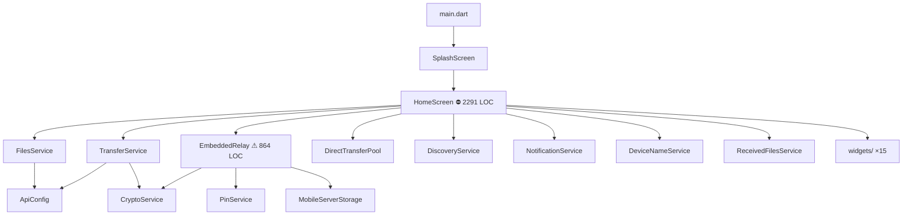
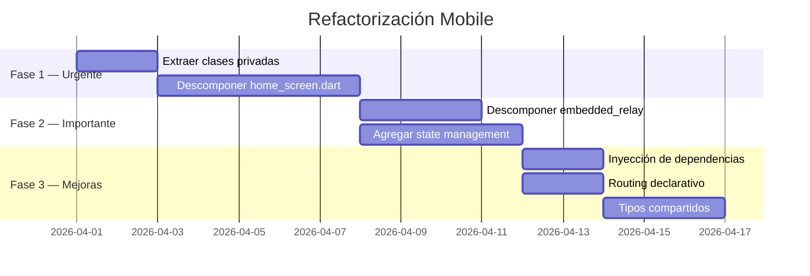

# Revisión de Arquitectura — Mobile SrvFiles (Flutter)

> **Fecha:** 28 de marzo de 2026  
> **Alcance:** `mobile/lib/` — 44 archivos Dart, ~7.500 LOC  
> **Stack:** Flutter (Dart ^3.11.3) · http · web_socket_channel · cryptography · file_picker · flutter_local_notifications · chewie · pdfx · flutter_svg

---

## 1. Estructura actual

```
mobile/lib/
├── main.dart                           ← Entry point (37 líneas) ✅
│
├── config/
│   └── api_config.dart                 ← URLs del backend (22 líneas) ✅
│
├── models/                             ← DTOs inmutables ✅
│   ├── file_info.dart                  ← 21 líneas
│   ├── disk_stats.dart
│   ├── app_config.dart
│   ├── transfer_client.dart
│   ├── transfer_request.dart
│   └── active_transfer.dart            ← Con copyWith()
│
├── screens/
│   ├── splash_screen.dart              ← ⚠ 438 líneas (discovery + UI)
│   ├── home_screen.dart                ← ⛔ 2.291 líneas — GOD WIDGET
│   └── preview_screen.dart             ← Vista previa de archivos
│
├── services/                           ← Lógica de negocio
│   ├── files_service.dart              ← CRUD archivos REST (161 líneas) ✅
│   ├── transfer_service.dart           ← WebSocket P2P (355 líneas) ✅
│   ├── crypto_service.dart             ← ECDH + AES-256-GCM (139 líneas) ✅
│   ├── discovery_service.dart          ← Scan LAN (143 líneas) ✅
│   ├── direct_transfer_pool.dart       ← Pool de conexiones WS (170 líneas) ✅
│   ├── embedded_relay.dart             ← ⚠ 864 líneas — HTTP + WS server
│   ├── notification_service.dart       ← Notificaciones locales (158 líneas) ✅
│   ├── received_files_service.dart     ← Storage recibidos (93 líneas) ✅
│   ├── mobile_server_storage_service.dart ← Storage servidor (141 líneas) ✅
│   ├── pin_service.dart                ← SHA-256 + SharedPreferences (59 líneas) ✅
│   ├── preview_service.dart            ← Lógica de preview
│   ├── device_name_service.dart        ← Nombre persistido
│   └── app_logger.dart                 ← Logger wrapper
│
├── theme/                              ← Design system ✅
│   ├── app_colors.dart                 ← Constantes de color
│   └── app_theme.dart                  ← ThemeData dark
│
├── utils/                              ← Funciones puras ✅
│   ├── format.dart                     ← formatBytes, stripProtocol
│   ├── file_icons.dart                 ← Extensión → emoji
│   └── file_type_helper.dart           ← Categorización de archivos
│
└── widgets/                            ← Componentes de UI reutilizables
    ├── disk_stats_bar.dart
    ├── file_grid_item.dart
    ├── file_list_item.dart
    ├── glass_card.dart
    ├── gradient_text.dart
    ├── incoming_transfer_dialog.dart
    ├── name_dialog.dart
    ├── online_clients.dart
    ├── pin_entry_dialog.dart
    ├── pulsing_dot.dart
    ├── qr_footer.dart
    ├── search_bar.dart
    ├── server_mode_warning_dialog.dart
    ├── skeleton_loader.dart
    └── upload_sheet.dart
```

### Diagrama de dependencias



---

## 2. Lo que está bien ✅

| Aspecto | Detalle |
|---|---|
| **Models** | DTOs inmutables con `factory fromJson()`, `copyWith()` |
| **Services bien acotados** | `FilesService`, `CryptoService`, `PinService`, `ReceivedFilesService` — cada uno < 170 líneas |
| **`transfer_service.dart`** | Bien encapsulado: protocolo WS completo con cifrado, callbacks limpios |
| **`direct_transfer_pool.dart`** | Pool con timeout de inactividad, reutilización de conexiones |
| **E2E encryption** | ECDH P-256 + HKDF + AES-256-GCM, compatible con el frontend web |
| **Design system** | `AppColors` + `AppTheme` centralizados, dark theme con constantes |
| **Widget catalog** | 15 widgets reusables bien separados en `widgets/` |
| **Foreground service** | `NotificationService` mantiene WS vivo en Android background |
| **Singleton pattern** | `NotificationService` y `AppLogger` como singletons |
| **Sanitización** | `MobileServerStorageService._sanitize()` previene path traversal |

---

## 3. Problemas detectados 🔍

### 3.1 — ⛔ `home_screen.dart` es un God Widget (2.291 líneas)

El problema **más crítico** del proyecto. Un solo archivo contiene:

| Concepto | Líneas aprox. |
|---|---|
| Imports | 44 |
| State variables | 25+ |
| Lifecycle (initState, dispose, didChangeAppLifecycleState) | ~50 |
| Relay management (start, server mode, auto-auth) | ~100 |
| Direct pool setup + scanning | ~100 |
| PIN auth dialogs | ~50 |
| P2P transfer logic (send, receive, chunks, cancel) | ~200 |
| File operations (upload, download, share, delete) | ~150 |
| Utility methods | ~50 |
| UI Build methods | **~1.200** |
| Private helper classes (`_ReceiveBuffer`, `_PendingSend`, `_ConnectSheet`) | ~300 |

**Impacto:** Es imposible testear, mantener o agregar features sin riesgo de romper algo. Cada bug fix toca un archivo de 2.300 líneas.

### 3.2 — `embedded_relay.dart` es un servidor completo en un archivo (864 líneas)

Un solo archivo que implementa:
- HTTP server con CORS
- Router de endpoints REST (7+ rutas)
- Autenticación con PIN + rate limiting
- File storage (upload/download/delete con multipart)
- WebSocket relay con signaling completo
- Key exchange ECDH server-side
- Serving de frontend estático (SPA)
- Binary frame relay con cifrado/descifrado

No tiene tests, y un bug en el relay es difícil de depurar.

### 3.3 — No hay state management

Todo el estado vive en `_HomeScreenState` con `setState()`:

```dart
// 25+ variables de estado en un solo StatefulWidget
List<FileInfo> _files = [];
DiskStats? _stats;
AppConfig? _config;
bool _loading = true;
String? _error;
bool _isGridView = false;
List<File> _stagedFiles = [];
bool _uploading = false;
double _uploadProgress = 0;
String? _myClientId;
List<TransferClient> _onlineClients = [];
ActiveTransfer? _activeTransfer;
String _deviceName = '';
Map<String, _ReceiveBuffer> _receiveBuffers = {};
_PendingSend? _pendingSend;
List<FileInfo> _receivedFiles = [];
List<DiscoveredServer> _directDevices = [];
// ...
```

Flutter tiene soluciones maduras para esto: `Riverpod`, `Provider`, `Bloc`, o `ChangeNotifier`.

### 3.4 — Lógica duplicada: Download dir

El mismo patrón de "obtener directorio de descarga" está duplicado en:
- `_HomeScreenState._getDownloadDir()` (L1008-1024)
- `ReceivedFilesService.getDirectory()` (L15-30)

Ambos resuelven el path de Android vs. iOS de forma similar pero no idéntica.

### 3.5 — Navegación imperativa con `pushReplacement`

La navegación entre pantallas se hace con `Navigator.pushReplacement` directo:

```dart
Navigator.of(context).pushReplacement(
  MaterialPageRoute(builder: (_) => HomeScreen(serverUrl: url)),
);
```

No hay routing declarativo, named routes, ni `GoRouter`. Dificulta deep linking y back-stack.

### 3.6 — Clases privadas inline en `home_screen.dart`

Tres clases privadas viven al final de `home_screen.dart`:
- `_ReceiveBuffer` — buffer de chunks P2P
- `_PendingSend` — estado de envío pendiente
- `_ConnectSheet` — bottom sheet completo (~200 líneas)

Estas deberían ser clases top-level en sus propios archivos.

### 3.7 — Sin inyección de dependencias

Los servicios se instancian directamente en el widget:

```dart
final TransferService _transferService = TransferService();
final DeviceNameService _deviceNameService = DeviceNameService();
final ReceivedFilesService _receivedFilesService = ReceivedFilesService();
final EmbeddedRelay _relay = EmbeddedRelay();
```

Esto impide:
- Testabilidad (no se pueden mockear)
- Compartir instancias entre screens
- Swappear implementaciones

### 3.8 — `splash_screen.dart` mezcla concerns (438 líneas)

Combina:
- Lógica de discovery (scan LAN, probe, manual connect)
- Persistencia del último servidor
- UI completa de la pantalla de conexión

### 3.9 — UUID generation casera

```dart
String _generateTransferId() {
  final now = DateTime.now().microsecondsSinceEpoch;
  final hex = now.toRadixString(16).padLeft(12, '0');
  return '${hex.substring(0, 8)}-${hex.substring(8, 12)}-4000-8000-...';
}
```

Se usa `DateTime` para generar UUIDs, lo cual puede colisionar en transferencias simultáneas. Debería usarse el paquete `uuid` o `Random.secure()` (como sí hace `embedded_relay.dart`).

### 3.10 — Tipos duplicados entre plataformas

`FileInfo`, `DiskStats`, `AppConfig`, `TransferClient` están definidos por separado en:
- `backend/src/types/`
- `frontend/src/api/`
- `mobile/lib/models/`

Tres copias manuales sin sincronización automática.

---

## 4. Propuesta de mejora

### 4.1 — Descomponer `home_screen.dart`

```
lib/
├── features/                               ← [NUEVO] Feature-based
│   ├── files/
│   │   ├── files_controller.dart           ← Estado y lógica de archivos
│   │   ├── files_section.dart              ← UI: lista/grilla + búsqueda
│   │   ├── upload_controller.dart          ← Estado de uploads
│   │   └── download_helper.dart            ← Lógica de descarga/share
│   ├── transfer/
│   │   ├── transfer_controller.dart        ← Estado P2P (activeTransfer, buffers)
│   │   ├── receive_buffer.dart             ← [EXTRAÍDO] de _ReceiveBuffer
│   │   ├── pending_send.dart               ← [EXTRAÍDO] de _PendingSend
│   │   └── transfer_section.dart           ← UI: online clients + progress  
│   ├── server/
│   │   ├── server_mode_controller.dart     ← Lógica de modo servidor
│   │   ├── connect_sheet.dart              ← [EXTRAÍDO] de _ConnectSheet
│   │   └── server_label.dart               ← Chip/badge del servidor
│   └── direct/
│       ├── direct_mode_controller.dart     ← Scanning + pool management
│       └── direct_devices_section.dart     ← UI: dispositivos directos
│
├── screens/
│   ├── home_screen.dart                    ← SOLO orquesta features (~200 líneas)
│   ├── splash_screen.dart                  ← SOLO UI (~150 líneas)
│   └── preview_screen.dart
```

**Resultado:** `home_screen.dart` pasaría de 2.291 → ~200 líneas.

### 4.2 — Descomponer `embedded_relay.dart`

```
lib/services/relay/
├── embedded_relay.dart                 ← Solo lifecycle (start/stop) + router
├── relay_http_handler.dart             ← Endpoints REST: auth, files, config
├── relay_ws_handler.dart               ← Signaling WS + key exchange
├── relay_binary_handler.dart           ← Relay de chunks binarios
├── relay_auth.dart                     ← Rate limiting + sessions
└── relay_static_server.dart            ← Serving de frontend estático
```

### 4.3 — State management con Riverpod

```dart
// providers/files_provider.dart
@riverpod
class FilesNotifier extends _$FilesNotifier {
  @override
  AsyncValue<List<FileInfo>> build() => const AsyncLoading();

  Future<void> load() async {
    state = const AsyncLoading();
    state = await AsyncValue.guard(() => ref.read(filesServiceProvider).getFiles());
  }

  Future<void> refresh() async { /* ... */ }
  Future<void> deleteFile(String name) async { /* ... */ }
}
```

**Alternativa más simple:** `ChangeNotifier` + `Provider` si Riverpod parece overengineering.

### 4.4 — Inyección de dependencias

```dart
// Con Riverpod:
final transferServiceProvider = Provider<TransferService>((ref) => TransferService());
final relayProvider = Provider<EmbeddedRelay>((ref) => EmbeddedRelay());

// O con GetIt (service locator):
GetIt.I.registerLazySingleton<TransferService>(() => TransferService());
```

### 4.5 — Routing declarativo

```dart
// Con GoRouter:
final router = GoRouter(
  routes: [
    GoRoute(path: '/', builder: (_, __) => const SplashScreen()),
    GoRoute(path: '/home', builder: (_, state) => HomeScreen(serverUrl: state.extra)),
    GoRoute(path: '/preview', builder: (_, state) => PreviewScreen(file: state.extra)),
  ],
);
```

### 4.6 — Unificar directorio de descargas

```dart
// lib/services/download_dir_service.dart
class DownloadDirService {
  Future<Directory> getDownloadsDir() async { /* ... */ }
  Future<Directory> getReceivedDir() async  { /* ... */ }
  Future<Directory> getServerDir() async    { /* ... */ }
}
```

---

## 5. Tabla resumen: Prioridades

| Patrón / Mejora | Impacto | Prioridad |
|---|---|---|
| **Descomponer `home_screen.dart`** | Eliminará 2.000 líneas del God Widget | 🔴 Crítica |
| **Descomponer `embedded_relay.dart`** | Server modular y testeable | 🟢 Alta |
| **State management (Provider/Riverpod)** | Elimina 25+ `setState()` | 🟢 Alta |
| **Inyección de dependencias** | Testabilidad | 🟡 Media |
| **Routing declarativo** | Deep linking, back-stack | 🟡 Media |
| **Extraer clases privadas inline** | Reusabilidad, testing | 🟡 Media |
| **Unificar `_getDownloadDir()`** | Eliminar duplicación | 🟡 Media |
| **UUID con `Random.secure()`** | Evitar colisiones | 🟡 Media |
| **Tipos compartidos (codegen)** | Eliminar 3 copias manuales | 🔵 Baja |
| **Separar concerns de `SplashScreen`** | Limpieza | 🔵 Baja |

---

## 6. Comparativo de complejidad por pantalla

| Archivo | Líneas | Imports | State vars | Métodos | Widgets build |
|---|---|---|---|---|---|
| `home_screen.dart` | **2.291** | 44 | 25+ | 30+ | 15+ |
| `splash_screen.dart` | 438 | 8 | 5 | 6 | 3 |
| `preview_screen.dart` | ~150 | ~5 | ~3 | ~2 | ~2 |

`home_screen.dart` tiene **5x más código** que las otras dos pantallas combinadas.

---

## 7. Relación con backend y frontend

| Mobile | Backend | Frontend | Oportunidad |
|---|---|---|---|
| `embedded_relay.dart` | `transfer.service.ts` | — | Mismo protocolo WS, lógica duplicada |
| `models/*.dart` | `types/index.ts` | `api/files.api.ts` | Tipos duplicados ×3 |
| `crypto_service.dart` | `cryptoHelper.ts` | `crypto.ts` | ECDH + AES-GCM idéntico en 3 lenguajes |
| `discovery_service.dart` | `discovery.service.ts` | `discovery.api.ts` | Scan LAN duplicado (mobile nativo + backend) |

> **Nota:** La app móvil incluye un **servidor embebido** (`embedded_relay.dart`) que replica parcialmente el backend de Node.js. Esto es intencionado para el modo offline/P2P, pero la duplicación de lógica (auth, file storage, WS relay) es una fuente potencial de inconsistencias.

---

## 8. Roadmap sugerido



---

*Documento generado como referencia para futuras refactorizaciones de la app mobile de SrvFiles.*
